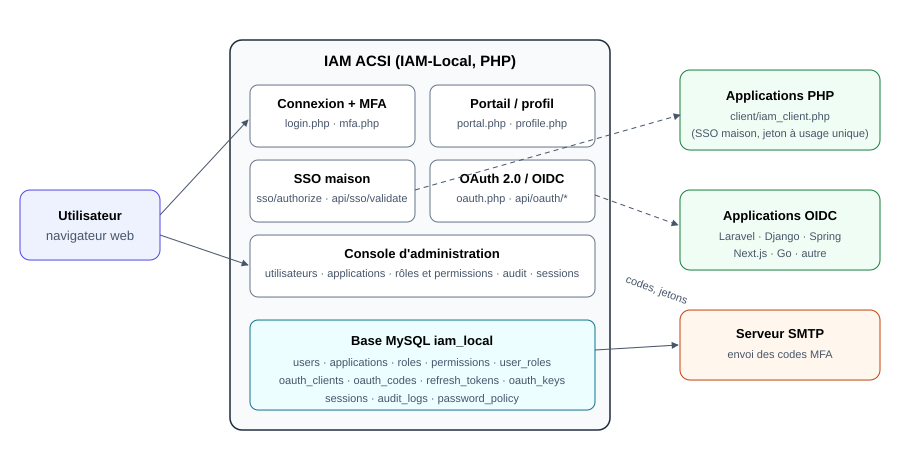

# Introduction

## Qu'est-ce que l'IAM ACSI

L'IAM ACSI (projet *IAM-Local*) est la plateforme d'identité et d'accès des applications de l'ACSI. Elle remplit quatre fonctions :

- **une seule connexion** pour toutes les applications (SSO) : l'utilisateur s'identifie une fois sur l'IAM, puis ouvre ses applications sans ressaisir son mot de passe ;
- **une vérification en deux étapes** (MFA) par code envoyé par e-mail ;
- **la gestion centralisée des droits** : chaque application déclare ses permissions, l'IAM les regroupe en rôles, et un utilisateur n'entre dans une application que s'il y possède au moins un rôle ;
- **la traçabilité** : connexions, échecs, refus d'accès, renouvellements de jetons et actions d'administration sont inscrits au journal d'audit.

L'IAM parle deux protocoles :

| Protocole | Pour qui | Principe |
|---|---|---|
| **SSO maison** | Applications PHP historiques (Gestion des Présences, Gestion des Salaires…) | L'IAM remet à l'application un jeton à usage unique, que l'application valide auprès de `api/sso/validate.php` |
| **OAuth 2.0 / OpenID Connect** | Applications modernes (Laravel, Django, Spring Boot, Next.js, Go…) | Flux *Authorization Code* avec PKCE ; jetons JWT signés RS256, vérifiables avec la clé publique (JWKS) |

## Architecture



*Schéma 1 — Architecture générale : l'IAM, sa base et les applications clientes*

- L'IAM est une application PHP servie par Apache (WampServer en local), avec une base MySQL `iam_local`.
- Les applications clientes ne voient **jamais** le mot de passe de l'utilisateur : elles reçoivent un jeton.
- Les rôles sont **locaux à chaque application** : le rôle `admin` de l'application *Partenaires* ne donne aucun droit sur la console IAM. L'administration de l'IAM est portée par le rôle `admin` de l'application système `iam-admin`.

## Prérequis

- **Navigateur** : Chrome, Edge ou Firefox récent, avec les cookies et JavaScript activés.
- **Réseau** : accès à l'URL de l'IAM (par défaut `http://localhost/IAM-Local`) et aux applications.
- **Messagerie** : une adresse e-mail valide pour recevoir les codes MFA.
- **Administrateurs** : un compte portant le rôle `admin` sur l'application `iam-admin`.

> Toutes les captures de ce guide ont été réalisées sur une instance de **démonstration** (données fictives). Les zones sensibles (mots de passe, codes) sont floutées.

# Première connexion

## Écran de connexion

Ouvrez l'URL de l'IAM. L'écran de connexion demande :

- l'**adresse e-mail ou l'identifiant** (login) ;
- le **mot de passe**.


*Figure 1 — Écran de connexion de l'IAM*

En cas d'erreur, le message « Identifiants incorrects » s'affiche. Il ne précise volontairement pas si c'est l'identifiant ou le mot de passe qui est faux.


*Figure 2 — Message affiché après un mot de passe erroné*

Le lien « Connexion sans mot de passe (téléphone / code) » ouvre une connexion par code à usage unique, si elle est activée pour votre compte.

## MFA : réception et saisie du code

Après un mot de passe correct, un **code à 6 chiffres** est envoyé par e-mail :

- **tous les comptes non administrateurs** reçoivent un code, car la politique `MFA_FORCE_ALL` est active ;
- un compte qui a activé la MFA individuellement reçoit aussi un code ;
- les **administrateurs IAM sont exemptés** de la MFA. C'est un choix volontaire de l'organisation.


*Figure 3 — Vérification en deux étapes : saisie du code reçu par e-mail*

Règles du code :

- valable **5 minutes** ;
- **5 essais** au maximum ; au-delà, retour à l'écran de connexion ;
- le lien « Renvoyer le code » invalide l'ancien code et en envoie un nouveau.

> **Mode démonstration.** Si aucun serveur SMTP n'est configuré (Administration › E-mail & MFA), le code s'affiche directement sur la page, dans un bandeau orange. Ce mode ne doit **jamais** être utilisé en production.

## Politique de mot de passe

Valeurs par défaut, modifiables dans Administration › Paramètres (§ 8) :

| Règle | Valeur par défaut |
|---|---|
| Longueur minimale | 8 caractères |
| Complexité | au moins une majuscule, une minuscule, un chiffre et un caractère spécial |
| Historique | les 5 derniers mots de passe ne peuvent pas être réutilisés |
| Expiration | 90 jours ; à l'échéance, le changement est imposé à la connexion |
| Premier mot de passe | comptes importés par CSV : un bandeau du portail invite à le changer (changement non bloquant) |

## Déblocage après 5 échecs (30 minutes)

Après **5 mots de passe erronés**, le compte est **verrouillé pendant 30 minutes** :


*Figure 4 — Compte verrouillé après 5 tentatives échouées*

Pour retrouver l'accès :

- **attendre 30 minutes** : le déblocage est automatique ;
- si l'utilisateur a oublié son mot de passe, un administrateur le réinitialise (§ 4.4). La réinitialisation **ne lève pas** le verrouillage en cours. Pour débloquer immédiatement, voir § 10.4, étape 1 ;
- en parallèle, une limite par **adresse IP** (60 échecs en 15 minutes) protège contre les attaques par force brute.

Chaque verrouillage est inscrit au journal d'audit (`account_locked`).

# Le portail utilisateur

## Vue des applications accessibles

Après la connexion, le portail (`portal.php`) affiche **uniquement les applications sur lesquelles vous avez un rôle**, ainsi que vos rôles.


*Figure 5 — Portail d'un utilisateur : une application accessible et son rôle*

Un administrateur IAM voit en plus la rubrique *Administration* dans le menu de gauche :


*Figure 8 — Portail d'un administrateur : applications et accès à la console*

## Lancer une application via SSO

Cliquez sur **Accéder** :

1. l'IAM vérifie que votre session est valide et que vous avez un rôle sur l'application ;
2. l'IAM crée un jeton à usage unique, valable 60 secondes, et vous redirige vers l'application ;
3. l'application valide le jeton auprès de l'IAM et ouvre votre session avec vos rôles et vos permissions.

Pour une application OIDC (Laravel, par exemple), l'IAM affiche d'abord un écran de **consentement** qui liste les informations transmises :


*Figure 32 — Consentement OAuth 2.0 / OIDC avant l'ouverture de l'application*

Si vous n'avez **aucun rôle** sur l'application demandée, l'IAM refuse l'accès avant tout échange de jeton. L'application reçoit alors l'erreur normalisée `access_denied` :


*Figure 33 — Accès refusé : utilisateur connecté mais sans rôle sur l'application*

Dans ce cas, demandez à un administrateur de vous attribuer un rôle (§ 6.4).

## Consulter son profil

Le menu **Mon profil** (`profile.php`) affiche :

- vos informations personnelles (nom, identifiant, e-mail, matricule, organisation) ;
- vos **rôles et permissions** pour chaque application ;
- l'état de la MFA ;
- vos **sessions actives**, avec le bouton « Tout déconnecter ailleurs ».


*Figure 6 — Page « Mon profil » : identité, rôles et permissions*

## Changer son mot de passe

Dans **Mon profil › Changer le mot de passe** :

1. saisissez le mot de passe actuel ;
2. saisissez deux fois le nouveau mot de passe ;
3. cliquez sur **Mettre à jour**.

Si le nouveau mot de passe ne respecte pas la politique, chaque règle non respectée est listée :


*Figure 7 — Changement de mot de passe refusé : règles de la politique non respectées*

# Administration — Utilisateurs

La console d'administration (`admin/`) s'ouvre sur un tableau de bord : nombre de comptes, d'applications et de sessions, utilisateurs par application et dernières connexions.


*Figure 9 — Tableau de bord de la console d'administration*

Menu **Administration › Utilisateurs** (`admin/users.php`).


*Figure 10 — Liste des utilisateurs : statut, rôles par application, dernière connexion*

## Créer un utilisateur

1. Cliquez sur **Nouvel utilisateur**.
2. Renseignez au minimum le **prénom**, le **nom**, l'**e-mail** et un **mot de passe temporaire**.
3. Si besoin, complétez l'identifiant, le matricule, l'organisation, la direction, le service et la fonction.
4. Dans **Rôles par application**, choisissez un rôle pour chaque application à ouvrir à l'utilisateur. Sans rôle, l'utilisateur ne voit aucune application.
5. Cliquez sur **Créer**.


*Figure 11 — Formulaire de création d'un utilisateur (mot de passe flouté)*

Transmettez le mot de passe à l'utilisateur par un canal distinct de l'e-mail qui contient son identifiant, et demandez-lui de le changer dès sa première connexion (§ 3.4).

> Un compte créé à la main n'est **pas** marqué « mot de passe à changer ». Le changement est imposé seulement à l'expiration, au bout de 90 jours.

## Modifier, désactiver, réactiver

Cliquez sur l'icône de modification d'une ligne :


*Figure 12 — Modification d'un utilisateur : identité, statut, rôles par application*

- **Désactiver** : passez le *Statut* à « Inactive ». L'utilisateur ne peut plus se connecter, et ses jetons ne sont plus renouvelés.
- **Réactiver** : remettez le statut à « Active ».
- **Supprimer** (bouton rouge de la liste) : suppression définitive. Préférez la désactivation, qui conserve l'historique d'audit lisible.

## Réinitialiser un mot de passe

Bouton **Mot de passe** sur la ligne de l'utilisateur :


*Figure 13 — Réinitialisation du mot de passe par un administrateur*

Le nouveau mot de passe doit respecter la politique et ne peut pas reprendre l'un des 5 derniers mots de passe de l'utilisateur.

> **Comportement actuel, à connaître.** Malgré la mention « Obligatoire au prochain login » affichée dans la fenêtre :
>
> - le changement n'est **pas** imposé, car `must_change_password` est remis à 0 ;
> - la réinitialisation ne lève **pas** un verrouillage en cours.
>
> Demandez à l'utilisateur de changer lui-même ce mot de passe depuis son profil (§ 3.4). Pour débloquer un compte immédiatement, suivez le § 10.4, étape 1.

## Réinitialiser la MFA

La MFA de l'IAM est un **code envoyé par e-mail** : aucun appareil ni application d'authentification n'est enrôlé. Il n'y a donc pas de « second facteur » à réinitialiser. Si un utilisateur ne reçoit pas ses codes :

1. vérifiez son **adresse e-mail** dans sa fiche (§ 4.2) ;
2. vérifiez la **configuration SMTP** et envoyez un e-mail de test (Administration › E-mail & MFA, figure 31) ;
3. demandez-lui d'utiliser « Renvoyer le code » ;
4. si le code a été trop souvent saisi de travers, il suffit de recommencer la connexion.

## Importer en masse (CSV)

Bouton **Importer (CSV)** :


*Figure 14 — Import des utilisateurs à partir d'un fichier CSV*

- Colonnes : `email;first_name;last_name;username;phone;matricule;organization;department;service;fonction;status`.
- Séparateur `;` ou `,`, encodage UTF-8. Le lien « Télécharger le modèle » fournit un fichier prêt à remplir.
- Les e-mails déjà présents sont ignorés.
- Option « Mots de passe forts + changement obligatoire » : chaque compte importé reçoit un mot de passe aléatoire conforme et il est marqué « mot de passe à changer ». Le portail affiche alors un bandeau d'invitation.

# Administration — Applications

L'IAM gère deux familles d'applications :

- **Applications SSO maison**, dans le menu **Applications** (`admin/apps.php`) ;
- **Applications OAuth / OIDC**, dans le menu **OAuth / OIDC** (`admin/oidc_apps.php`).


*Figure 15 — Liste des applications : permissions, accès utilisateurs, intégration SSO*

## Créer une application

### Application SSO maison

En bas de la page **Applications**, la rubrique **Ajouter une application** se déroule en trois étapes :

1. **Application** : nom, code technique (généré depuis le nom), URL et description ;
2. **Connexion IAM** : mode d'accès (ressaisie des identifiants ou accès transparent), pont de session éventuel ;
3. **Vérification** : contrôle de l'URL et de l'environnement avant la création.


*Figure 16 — Ajout d'une application SSO maison, étape « Application »*

Le bouton **Intégration SSO** d'une application génère le fichier d'intégration `iam-sso-<code>.php` et explique où le placer :


*Figure 17 — Intégration SSO automatique : fichier généré à déposer dans l'application*

### Application OAuth / OIDC

Menu **OAuth / OIDC › Nouvelle application**. L'assistant comporte trois étapes :


*Figure 18 — Liste des applications OAuth / OIDC*

1. **Plateforme & application** : choix de la plateforme (Laravel, Next.js, Django, PHP pur, Symfony, Node.js, Spring, Go, Autre), puis nom, identifiant (*slug*), URL de base et type de client.


*Figure 19 — Assistant OIDC : choix de la plateforme et informations générales*

2. **OAuth / OIDC** : redirect URIs, post-logout URIs, scopes, grant types, durée des jetons et PKCE (§ 5.3).


*Figure 20 — Assistant OIDC : redirect URIs, scopes et grant types*

3. **Rôles & validation** : correspondance facultative entre rôles IAM et rôles de l'application, puis création.

## Choisir SSO maison ou OIDC

| Critère | SSO maison | OAuth 2.0 / OIDC |
|---|---|---|
| Application existante en PHP natif | ✔ recommandé (fichier généré) | possible |
| Framework moderne (Laravel, Django, Spring, Next.js, Go) | — | ✔ recommandé |
| Bibliothèques standards du marché | non | oui (toute bibliothèque OIDC) |
| Jetons vérifiables hors ligne (JWT RS256) | non | oui (JWKS) |
| Renouvellement de session sans reconnexion | session locale | `refresh_token` avec rotation |
| Consentement explicite | non | oui |

Règle simple : **nouvelle application = OIDC**. Le SSO maison reste destiné aux applications PHP déjà branchées.

## Configurer les redirect_uri, PKCE et scopes

- **Redirect URIs** : URL exactes de retour, par exemple `http://localhost:8001/callback`. La comparaison est stricte : protocole, hôte, port et chemin doivent correspondre.
- **Post-logout URIs** : pages autorisées après la déconnexion, par exemple `…/logged-out`.
- **PKCE** :
  - **obligatoire** pour un client *public* (SPA, mobile), avec la méthode `S256` ;
  - **recommandé** aussi pour un client *confidentiel* : cochez « PKCE obligatoire ».
- **Scopes** :

  | Scope | Contenu |
  |---|---|
  | `openid` | session OIDC (`id_token`) |
  | `profile` | nom, prénom, identifiant |
  | `email` | adresse e-mail |
  | `roles` | rôles **et** permissions de l'utilisateur sur cette application |
  | `offline_access` | délivrance d'un `refresh_token` |

- **Grant types** :
  - `authorization_code` pour les utilisateurs ;
  - `refresh_token` pour le renouvellement ;
  - `client_credentials` pour un service sans utilisateur.

## Récupérer client_id / client_secret

- Le **client_id** est visible en permanence dans la fiche de l'application.
- Le **client_secret** n'est affiché **qu'une seule fois**, juste après la création ou après **Régénérer le secret**. Le fichier `.env` prêt à copier n'est téléchargeable qu'à ce moment-là.
- Dans l'IAM, le secret est stocké haché (bcrypt) : il est impossible de le relire.
- **Régénérer le secret** révoque tous les `refresh_token` en cours. Les utilisateurs de l'application devront se reconnecter.


*Figure 21 — Fiche d'une application OIDC : configuration, client ID, actions*

> Depuis la version 1.0.2, le **renouvellement** d'un jeton exige aussi le `client_secret` pour un client confidentiel. Un secret erroné dans le `.env` de l'application entraîne une déconnexion à l'expiration de l'access token (1 h par défaut).

## Tester la connexion

1. Dans la fiche OIDC, cliquez sur **Tester les endpoints** : l'IAM interroge ses propres endpoints OAuth/OIDC et affiche « OK » ou « Échec » pour chacun.
2. Ouvrez l'application cliente et connectez-vous avec un compte **qui a un rôle** sur elle.
3. Vérifiez au **journal d'audit** :
   - `oauth_consent`, puis `oauth_token` pour une connexion réussie ;
   - `oauth_authorize_denied` pour un compte sans rôle.
4. Pour une application Laravel, lancez les tests automatiques du § 9.1.

# Administration — Rôles et permissions

## Créer un rôle dans une application

Menu **Rôles & permissions** (`admin/roles.php`). Chaque carte représente un rôle et indique :

- son code ;
- l'application à laquelle il appartient ;
- le nombre de permissions qui lui sont attachées ;
- le nombre d'utilisateurs qui le portent.


*Figure 22 — Rôles par application*

Un rôle appartient **toujours** à une application. Le même code, par exemple `admin`, peut exister dans plusieurs applications sans aucun lien entre eux.

## Définir le catalogue de permissions

Le catalogue se gère application par application : **Applications › Permissions (n)**.


*Figure 24 — Catalogue des permissions d'une application*

- Convention de code : `<application>.<module>.<action>`, par exemple `partenaires.contacts.edit`.
- Le code est **unique sur toute la plateforme** ; c'est lui que l'application teste.
- Ne renommez pas un code utilisé par une application en service sans mettre à jour son code source.

## Matrice rôles × permissions (avec le joker *)

Bouton **Permissions** d'un rôle : cochez les permissions accordées.


*Figure 23 — Attribution des permissions à un rôle*

Le **joker `*`** est ajouté automatiquement aux permissions transmises à l'application dans deux cas :

- l'utilisateur porte le rôle `admin` **de cette application** ;
- l'utilisateur est **administrateur IAM**.

Le joker signifie « toutes les permissions de cette application ». Les adaptateurs fournis (Laravel, PHP natif, Django) l'interprètent ainsi.

## Assigner un rôle à un utilisateur

Deux chemins mènent au même résultat :

- depuis la fiche utilisateur, section **Rôles par application** (figure 12) ;
- depuis **Applications › Accès utilisateurs (n)**, qui liste les comptes ayant un rôle sur l'application :


*Figure 25 — Utilisateurs autorisés sur une application et leur rôle*

> Depuis la version 1.0.1, un utilisateur **sans rôle** sur une application OIDC reçoit `access_denied` (figure 33), **y compris un administrateur IAM**. Le SSO maison laisse toujours passer l'administrateur IAM.

## Cas particulier : rôle admin de iam-admin

- Le rôle `admin` de l'application **`iam-admin`** (rôle *système*, `is_system = 1`) est le seul qui ouvre la **console d'administration**.
- Le compte créé par `install.php` (identifiant 1) le reçoit automatiquement.
- Gardez **au moins deux administrateurs** actifs, pour ne jamais perdre l'accès (voir § 10.4).
- Les administrateurs IAM sont **exemptés de MFA** : c'est un choix volontaire. Protégez ces comptes par des mots de passe longs et uniques.

# Administration — Organisations et groupes

## Créer une organisation hiérarchique

Menu **Organisations** :

1. renseignez le **nom** et le **code** ;
2. choisissez le **type** (ministère, direction, service…) ;
3. choisissez l'**organisation parente**, ou « Aucune (racine) ».


*Figure 26 — Structure organisationnelle et formulaire « Nouvelle organisation »*

Données transmises aux applications :

- **SSO maison** : l'organisation de l'utilisateur (`organization_id`) ;
- **OIDC** : le point userinfo renvoie le service (claim `organization_unit`), la direction (`department`) et la fonction (`title`).

## Créer un groupe

Menu **Groupes › Nouveau groupe** : renseignez un nom et une description.


*Figure 27 — Création d'un groupe d'utilisateurs*

## Rattacher utilisateurs et applications

- **Utilisateur → organisation, groupes** : dans la fiche utilisateur, champs *Organisation* et *Groupes*.
- **Utilisateur → application** : par un **rôle** (§ 6.4). C'est le rôle, et lui seul, qui ouvre l'accès à une application.

Les groupes servent à organiser les comptes (filtres, listes). Ils ne donnent **aucun** droit par eux-mêmes.

# Administration — Audit et sessions

## Lire le journal d'audit

Menu **Journal d'audit** (`admin/audit.php`). Chaque ligne indique :

- la date et l'action ;
- l'utilisateur concerné et le détail ;
- l'application ;
- l'adresse IP, le pays et le navigateur.


*Figure 28 — Journal d'audit*

Actions utiles à connaître :

| Action | Signification |
|---|---|
| `login_success` / `account_locked` / `ip_rate_limited` | connexion réussie ; verrouillage après 5 échecs ; limite par IP atteinte |
| `mfa_verified` | code MFA validé |
| `sso_issue` / `sso_login` | jeton SSO émis par l'IAM ; puis validé par l'application |
| `oauth_consent` / `oauth_token` / `oauth_refresh` | code OIDC émis ; échangé contre des jetons ; jetons renouvelés |
| `oauth_authorize_denied` | accès OIDC refusé, par exemple `{"raison":"no_role_on_application"}` |
| `oauth_refresh_failed` | renouvellement refusé : `invalid_client_secret`, `client_mismatch` ou `token_reuse` |
| `session_revoked` | session révoquée par un administrateur |

Un `token_reuse` signale qu'un ancien refresh token a été rejoué, ce qui peut indiquer un vol. Toute la lignée de jetons a alors été révoquée.

## Filtrer par utilisateur / action / date

- La zone **Rechercher** filtre sur le texte (e-mail, détail, IP).
- La liste **Toutes les actions** restreint à un type d'action.
- Les lignes sont triées de la plus récente à la plus ancienne.

Pour une période précise ou un export, interrogez la table `audit_logs` (colonne `created_at`) dans phpMyAdmin.

## Révoquer une session active

Menu **Sessions** :

- **Révoquer** ferme une session ;
- **Tout révoquer** ferme toutes les sessions d'un utilisateur.


*Figure 29 — Sessions actives et révocation*

L'utilisateur peut aussi le faire lui-même depuis son profil (« Tout déconnecter ailleurs »).

## Rotation des clés RSA

Menu **OAuth / OIDC › Rotation JWKS** :

- une nouvelle paire de clés RSA 2048 est générée et devient la clé de signature ;
- les anciennes clés restent publiées dans le JWKS (`api/oauth/jwks.php`), donc les jetons déjà émis restent vérifiables jusqu'à leur expiration ;
- les applications qui mettent le JWKS en cache le rechargent quand elles rencontrent un `kid` inconnu (c'est le cas de l'adaptateur Laravel fourni).

Rythme conseillé : une rotation par an, et **immédiatement** en cas de doute sur la confidentialité de la base.

## Paramètres et e-mail

**Paramètres** : politique de mot de passe, durées de session, origines CORS de l'API.


*Figure 30 — Paramètres : politique de mot de passe et sécurité de l'API*

**E-mail & MFA** : configuration SMTP (Gmail, Outlook…) et envoi d'un e-mail de test.


*Figure 31 — Configuration de l'envoi des codes MFA (mot de passe flouté)*

# Intégration d'applications clientes

Les valeurs communes à toutes les intégrations OIDC se lisent dans le document de découverte `…/IAM-Local/.well-known/openid-configuration.php` :

| Élément | Valeur (installation locale) |
|---|---|
| Issuer | `http://localhost/IAM-Local` |
| Autorisation | `http://localhost/IAM-Local/oauth.php` |
| Jeton | `http://localhost/IAM-Local/api/oauth/token.php` |
| UserInfo | `http://localhost/IAM-Local/api/oauth/userinfo.php` |
| JWKS | `http://localhost/IAM-Local/api/oauth/jwks.php` |
| Déconnexion | `http://localhost/IAM-Local/logout.php` |

## Cas 1 : application Laravel

Le guide détaillé est `docs/guide-ajout-application-laravel.md`. En résumé :

1. **Déclarer l'application** : importer `sql/seed-app-<code>.sql`, qui crée l'application, le client OIDC (confidentiel, PKCE obligatoire), les permissions, les rôles et 3 comptes de test.
2. **Générer le squelette** : `py tools/generateur-app/generer.py` (pile `laravel`). Il est produit dans `tools/generateur-app/sortie/<code>/laravel/`.
3. **Copier le squelette** par-dessus un projet Laravel 11 neuf, puis :
   - `composer require firebase/php-jwt:^6.10` ;
   - copier `env.example` vers `.env` et renseigner `IAM_OIDC_CLIENT_SECRET` ;
   - `php artisan key:generate`.
4. **Tester de bout en bout** :

   ```bash
   php artisan serve --port=8001
   php artisan iam:test-login
   php tools/tests/test_integration_laravel.php --app=<code> --password=<mot de passe démo>
   ```

   La dernière commande se lance côté IAM.

## Cas 2 : application PHP native (iam_client.php + iam_gate.php)

**Fichiers à copier dans l'application :**

- `client/iam_client.php` : client SSO maison (cURL). Il redirige vers l'IAM, valide le jeton et ouvre la session locale.
- `iam_gate.php` : filtre d'interface par permissions, avec `peut()`, `iam_require()` et `iam_menu_item()`.

  > Ce fichier se trouve aujourd'hui dans `IAM-Local/IAM-Local/client/`, un dossier en double qui sera traité au chantier 2.

**Configuration**, en tête de chaque page protégée :

```php
define('IAM_APP_CODE', 'gestion-presence');            // code de l'application dans l'IAM
define('IAM_BASE_URL', 'http://localhost/IAM-Local');
require_once __DIR__ . '/iam_client.php';
require_once __DIR__ . '/iam_gate.php';
iam_client_config();
iam_client_require_login();
iam_require('presence.view');                          // garde de page
```

**Raccourci** : le bouton **Intégration SSO** (figure 17) génère un fichier `iam-sso-<code>.php` déjà configuré.

**Test de bout en bout** :

1. se connecter avec un compte qui a un rôle sur l'application : l'accès est accordé ;
2. se connecter avec un compte sans rôle : un message 403 s'affiche ;
3. vérifier les entrées `sso_issue` et `sso_login` au journal d'audit.

## Cas 3 : application Django (adaptateur existant)

Deux possibilités :

**SSO maison**
: adaptateur `tools/generateur-app/piles/django/iam.py.gabarit`, généré par `generer.py` (pile `django`). Il fournit :
  - `authorize_url()` et `exchange_sso_token()` ;
  - `fetch_profile()`, avec un cache des profils réglable par `IAM_PROFILE_CACHE_TTL`.

**OIDC standard**
: bibliothèque `mozilla-django-oidc`. L'assistant OIDC (plateforme *Django*) fournit le bloc `settings.py` :

```python
INSTALLED_APPS += ['mozilla_django_oidc']
AUTHENTICATION_BACKENDS = ['mozilla_django_oidc.auth.OIDCAuthenticationBackend']
OIDC_RP_CLIENT_ID = os.environ['IAM_OIDC_CLIENT_ID']
OIDC_RP_CLIENT_SECRET = os.environ['IAM_OIDC_CLIENT_SECRET']
OIDC_OP_AUTHORIZATION_ENDPOINT = os.environ['IAM_OIDC_ISSUER'] + '/oauth.php'
OIDC_OP_TOKEN_ENDPOINT = os.environ['IAM_OIDC_ISSUER'] + '/api/oauth/token.php'
OIDC_OP_JWKS_ENDPOINT = os.environ['IAM_OIDC_ISSUER'] + '/api/oauth/jwks.php'
OIDC_RP_SIGN_ALGO = 'RS256'
```

**Test** : connexion avec un compte de test, puis lecture des claims `roles` et `permissions` de l'`id_token`.

## Cas 4 : application Spring Boot

**Dépendance** : `spring-boot-starter-oauth2-client`. Configuration dans `application.yml` :

```yaml
spring:
  security:
    oauth2:
      client:
        registration:
          iam:
            provider: iam
            client-id: ${IAM_OIDC_CLIENT_ID}
            client-secret: ${IAM_OIDC_CLIENT_SECRET}
            authorization-grant-type: authorization_code
            redirect-uri: ${IAM_OIDC_REDIRECT_URI}
            scope: openid,profile,email,roles
        provider:
          iam:
            issuer-uri: ${IAM_OIDC_ISSUER}
```

**Test** : `/login` doit rediriger vers l'IAM, puis l'application doit lire `roles` et `permissions` dans l'`OidcUser`.

## Cas 5 : application Next.js

**Bibliothèque** : `next-auth` (Auth.js), avec un client **public** et PKCE obligatoire.

```ts
// auth.ts
export const { handlers, auth, signIn, signOut } = NextAuth({
  providers: [{
    id: 'iam', name: 'IAM ACSI', type: 'oidc',
    issuer: process.env.IAM_OIDC_ISSUER,
    clientId: process.env.IAM_OIDC_CLIENT_ID,
    clientSecret: process.env.IAM_OIDC_CLIENT_SECRET,
    checks: ['pkce', 'state'],
  }],
});
```

**Test** : la page protégée doit rediriger vers l'IAM, puis la session doit contenir l'e-mail et les rôles.

## Cas 6 : application Go

**Bibliothèques** : `golang.org/x/oauth2` et `github.com/coreos/go-oidc/v3`.

```go
provider, err := oidc.NewProvider(ctx, os.Getenv("IAM_OIDC_ISSUER"))
oauthConfig := oauth2.Config{
    ClientID:     os.Getenv("IAM_OIDC_CLIENT_ID"),
    ClientSecret: os.Getenv("IAM_OIDC_CLIENT_SECRET"),
    RedirectURL:  os.Getenv("IAM_OIDC_REDIRECT_URI"),
    Endpoint:     provider.Endpoint(),
    Scopes:       []string{oidc.ScopeOpenID, "profile", "email", "roles"},
}
```

**Test** : vérifier l'`id_token` avec `provider.Verifier(&oidc.Config{ClientID: …})`, puis lire les claims.

## Cas 7 : application quelconque via OIDC standard

Toute bibliothèque certifiée OpenID Connect convient. La configuration se fait en quatre étapes :

1. créer l'application dans **OAuth / OIDC** avec la plateforme « Autre » ;
2. déclarer l'**issuer** `http://localhost/IAM-Local`. Si la bibliothèque ne lit pas la découverte, renseigner les endpoints du tableau ci-dessus ;
3. utiliser le flux **Authorization Code + PKCE S256** et l'authentification client `client_secret_basic` ou `client_secret_post` ;
4. vérifier les JWT en **RS256** avec le JWKS.

**Test de bout en bout**, pour toutes les plateformes :

| Scénario | Résultat attendu |
|---|---|
| Compte **avec rôle** | connexion OK ; `roles` et `permissions` reçus |
| Compte **sans rôle** | `?error=access_denied` sur la redirect URI |
| Renouvellement avec le bon secret | 200 et nouveau `refresh_token` |
| Renouvellement avec un mauvais secret | 401 `invalid_client` |

Le script `php tools/tests/test_oauth_securite.php` rejoue automatiquement ces scénarios côté IAM.

# Dépannage

## Erreurs courantes et solutions

| Symptôme | Cause probable | Solution |
|---|---|---|
| Page « Configuration de l'IAM incomplète » | `config/config.php` ou `config.local.php` absent ou incomplet | Relancer `install.php` (supprimer `.installed`) ou compléter depuis `config/config.template.php` — voir `docs/installation.md` |
| « Compte temporairement verrouillé » | 5 échecs consécutifs | Attendre 30 min, ou débloquer en base (§ 10.4, étape 1) |
| « Compte désactivé ou en attente » | Statut inactif | Réactiver le compte (§ 4.2) |
| Code MFA jamais reçu | SMTP non configuré ou refusé | E-mail & MFA › envoyer un e-mail de test ; vérifier les identifiants SMTP |
| « Accès refusé » / `access_denied` à l'ouverture d'une application | Aucun rôle sur cette application | Attribuer un rôle (§ 6.4) |
| « redirect_uri invalide pour ce client » | URL de retour non déclarée ou différente (port, `/` final) | Corriger les Redirect URIs du client OIDC |
| `invalid_client` au renouvellement | `client_secret` du `.env` différent de l'IAM | Régénérer le secret et mettre à jour le `.env` |
| `invalid_grant` « déjà utilisé ou révoqué » | Refresh token rejoué ou renouvellements simultanés | Se reconnecter ; vérifier qu'un seul processus renouvelle les jetons |
| « Un code_challenge PKCE S256 valide est obligatoire » | Le client n'envoie pas PKCE | Activer PKCE S256 dans la bibliothèque cliente |
| Jetons refusés après une rotation JWKS | Cache JWKS figé côté application | Vider le cache JWKS ou redémarrer l'application |

## Où regarder les logs

- **Journal d'audit** de l'IAM : menu Journal d'audit, ou table `audit_logs`.
- **Événements OAuth par client** : table `oauth_client_events`, qui contient `authorization_granted`, `authorization_denied`, `token_issued` et `refresh_failed`.
- **Erreurs PHP** : `C:\wamp64\logs\php_error.log`.
- **Erreurs Apache** : `C:\wamp64\logs\apache_error.log`.
- **Application Laravel** : `storage/logs/laravel.log`, qui contient les entrées préfixées `[IAM]`.

## Scripts de diagnostic

| Script | Usage |
|---|---|
| `php tools/tests/test_oauth_securite.php` | Contrôles de sécurité OAuth (rôle requis, secret au refresh, rotation, rejeu) sur des données temporaires |
| `php tools/tests/test_integration_laravel.php --app=<code> --password=…` | Connexion complète des comptes de test d'une application Laravel (SSO et OIDC), comparaison des droits |
| `php -r "require 'includes/functions.php'; echo 'OK';"` | Vérifie que la configuration est complète (liste les constantes manquantes sinon) |
| `php artisan iam:check` (dans l'application Laravel) | Vérifie la configuration IAM de l'application |
| `_check_state.php`, `_test_*.php` (racine, non versionnés, bloqués par `.htaccess`) | Anciens scripts de diagnostic ponctuels |

> Le dossier `tools/diagnostics/` n'existe pas encore. Les scripts ci-dessus en tiennent lieu.

## Réinitialisation d'urgence (admin bloqué)

Si plus aucun administrateur ne peut se connecter, interrogez directement la base depuis le serveur, avec phpMyAdmin ou la console MySQL.

**1. Débloquer le compte** (identifiant 1 = premier administrateur) :

```sql
UPDATE users SET status = 'active', failed_attempts = 0, locked_until = NULL WHERE id = 1;
DELETE FROM login_attempts WHERE success = 0;
```

**2. Définir un nouveau mot de passe temporaire.** La commande suivante, lancée depuis la racine de l'IAM, affiche une empreinte :

```bash
php -r "require 'includes/functions.php'; echo iam_hash_password('Nouveau!MotDePasse2026'), PHP_EOL;"
```

Placez cette empreinte dans la requête suivante :

```sql
UPDATE users SET password_hash = '<empreinte affichée>', must_change_password = 1 WHERE id = 1;
```

**3. Vérifier que le compte porte toujours le rôle d'administration :**

```sql
SELECT r.code, a.code FROM user_roles ur
  JOIN roles r ON r.id = ur.role_id JOIN applications a ON a.id = ur.application_id
 WHERE ur.user_id = 1 AND a.code = 'iam-admin';
```

**4. Se connecter, changer le mot de passe, puis vérifier le journal d'audit.**

> `install.php` peut aussi réécrire le compte administrateur (identifiant 1). Ne l'utilisez qu'en dernier recours : il régénère aussi la clé JWT, ce qui invalide les jetons SSO en cours.

# Annexes

## Glossaire

| Terme | Définition |
|---|---|
| **IAM** | *Identity and Access Management* : gestion des identités et des accès |
| **SSO** | *Single Sign-On* : une connexion unique pour plusieurs applications |
| **OAuth 2.0** | Protocole de délégation d'accès par jetons (RFC 6749) |
| **OIDC** | *OpenID Connect* : couche d'identité au-dessus d'OAuth 2.0 (`id_token`, userinfo) |
| **PKCE** | *Proof Key for Code Exchange* (RFC 7636) : protège le code d'autorisation contre l'interception |
| **JWT** | *JSON Web Token* (RFC 7519) : jeton signé contenant des informations (claims) |
| **JWKS** | *JSON Web Key Set* : clés publiques servant à vérifier les JWT |
| **RBAC** | *Role-Based Access Control* : droits accordés par rôles |
| **MFA** | *Multi-Factor Authentication* : vérification en plusieurs étapes (ici, mot de passe + code e-mail) |
| **OTP** | *One-Time Password* : code à usage unique |
| **Client confidentiel / public** | Application capable (serveur) ou non (navigateur, mobile) de garder un secret |
| **Refresh token** | Jeton de longue durée servant à obtenir un nouvel access token sans reconnexion |
| **Rotation** | Remplacement à chaque usage (refresh token) ou périodique (clés RSA) |

## Références RFC

| Référence | Objet | Utilisation dans l'IAM |
|---|---|---|
| RFC 6749 | OAuth 2.0 | Flux Authorization Code, client credentials, refresh token (§ 6), erreurs `access_denied` (§ 4.1.2.1) |
| RFC 7636 | PKCE | `code_challenge` S256, obligatoire pour les clients publics |
| RFC 7519 | JWT | Access token et id_token signés RS256 |
| RFC 6819 | Modèle de menaces OAuth | Rotation des refresh tokens et révocation en cas de rejeu (§ 5.2.2.3) |
| OpenID Connect Core 1.0 | OIDC | id_token, userinfo, découverte |

## Matrice des rôles par application

**Applications Laravel *Partenaires* et *Stages & Emplois*** : la matrice est identique pour chaque module.

| Rôle | view | create | edit | delete | export |
|---|---|---|---|---|---|
| `admin` | ✔ | ✔ | ✔ | ✔ | ✔ (+ joker `*`) |
| `gestionnaire` | ✔ | ✔ | ✔ | — | ✔ |
| `utilisateur` | ✔ | — | — | — | — |

Modules couverts par cette matrice :

- *Partenaires* : `partenaires`, `contacts`, `conventions`, `documents`, `rapports` ;
- *Stages & Emplois* : `offres-emploi`, `candidatures`, `stages`, `conventions`, `employes`, `rapports`.

Chaque application a 3 comptes de test, un par rôle : `admin.<code>@acsi.local`, `gestionnaire.<code>@acsi.local` et `utilisateur.<code>@acsi.local`.

**Application système *iam-admin*** :

| Rôle | Permissions |
|---|---|
| `admin` (système) | `iam.admin`, `users.manage`, `roles.manage`, `audit.view` + joker `*` — donne accès à la console IAM |
| `agent`, `auditeur`, `gestionnaire_rh` | profils transversaux ; `auditeur` reçoit `audit.view` |

Le rôle `admin` d'une application métier **ne donne aucun droit** sur la console IAM.
